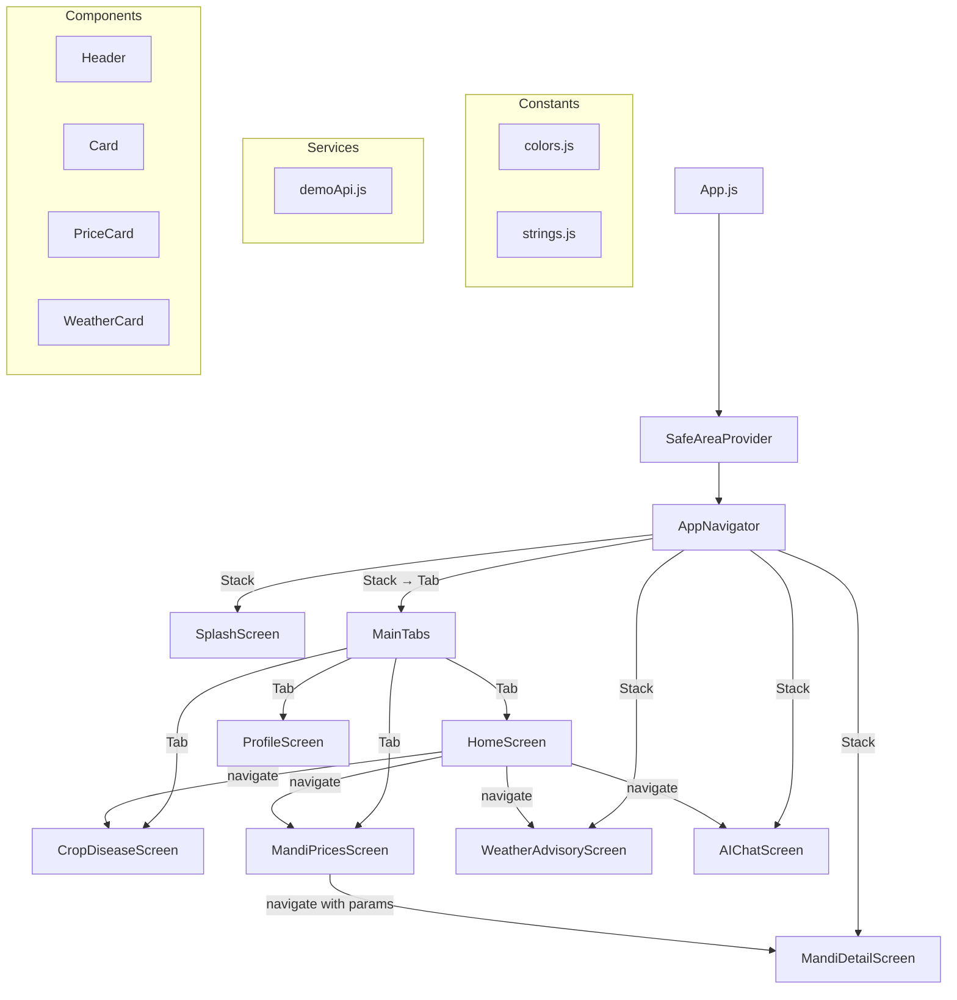
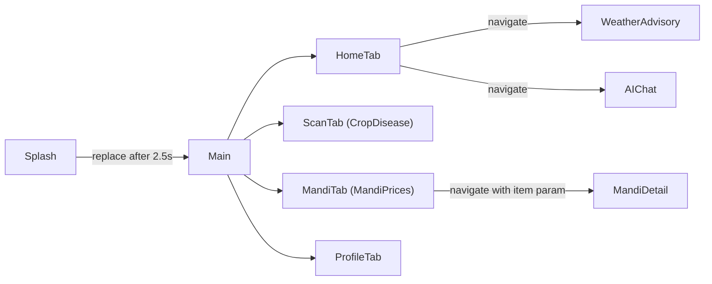
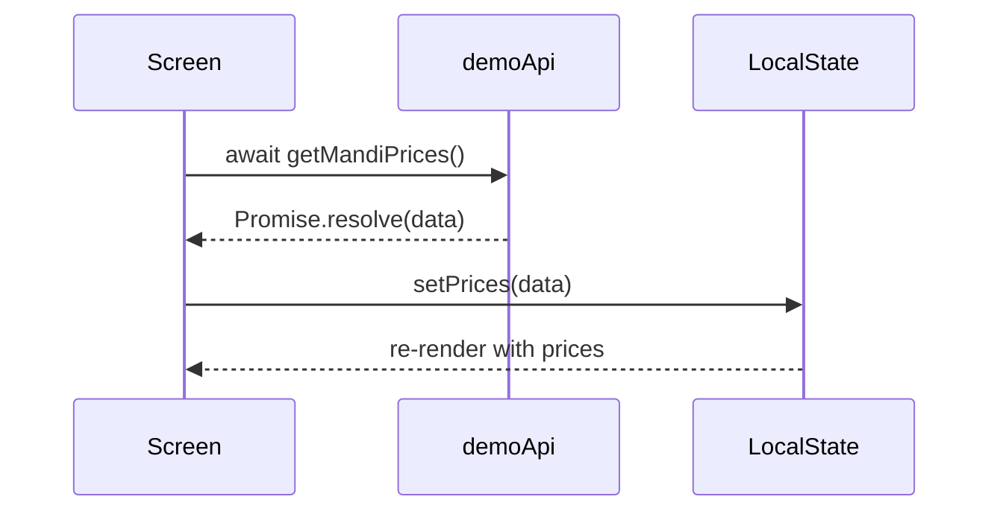

# Design Document: Kisan Sevak

## Overview

Kisan Sevak (किसान सेवक) is an Expo-managed React Native app targeting Android 8+ that provides Indian farmers with crop disease detection, live mandi price lookup, weather-based farming advisories, and a Hindi-language AI chat assistant. The existing codebase has several broken dependencies (`react-native-linear-gradient`, `react-native-vector-icons`, `react-native-image-picker`, `lottie-react-native`) that must be replaced with Expo-compatible equivalents before any screen work begins. All UI text is in Hindi (Devanagari Unicode). The app uses local component state only — no Context API or Redux.

---

## Architecture



---

## Navigation Structure



Two navigators are composed:
- **RootStack** (`@react-navigation/stack`) — hosts Splash and Main plus all full-screen detail stacks.
- **MainTabs** (`@react-navigation/bottom-tabs`) — four bottom tabs (Home, Scan, Mandi, Profile) mounted at the `Main` route.

`SplashScreen` calls `navigation.replace('Main')` (not `'Home'`) after 2 500 ms so the back button cannot return to splash.

---

## Package Dependency Changes

| Remove | Add |
|---|---|
| `react-native-linear-gradient` | `expo-linear-gradient` |
| `react-native-vector-icons` | `@expo/vector-icons` (Feather / Ionicons) |
| `react-native-image-picker` | `expo-image-picker` |
| `lottie-react-native` | Remove entirely; use simple `Animated` loading indicators |
| `react-native-shimmer-placeholder` | Remove; not used |

---

## Design System

```javascript
// colors.js
Colors = {
  primaryGreen:   '#1B5E20',
  secondaryGreen: '#4CAF50',
  accentAmber:    '#FF8F00',
  background:     '#F1F8E9',
  surfaceWhite:   '#FFFFFF',
  textPrimary:    '#1A2E0F',
  textSecondary:  '#4A6741',
  errorRed:       '#C62828',
  success:        '#2E7D32',
  border:         '#E0E0E0',
  shadow:         'rgba(0,0,0,0.08)',
  lightGreen:     '#C8E6C9',
  mutedGreen:     '#A5D6A7',
};

Typography = {
  title: 24, subtitle: 18, body: 14,
  caption: 12, label: 11, button: 15,
};
```

All cards use `borderRadius: 16`, `elevation: 3`. Hindi text uses `fontFamily: 'Noto Sans Devanagari'` with system font fallback.

---

## Components and Interfaces

### Component: Header

**Purpose**: App-wide top bar with optional back arrow and KS logo badge.

**Interface**:
```javascript
Header({ title: string, showBack?: boolean, onBackPress?: () => void })
```

**Responsibilities**:
- Render a white bar with bottom border.
- Show KS logo circle (amber text on green background) unless `showBack` is true, in which case show a `←` back button using `@expo/vector-icons` Feather `arrow-left`.
- Render `title` in Noto Sans, `Typography.subtitle`, `Colors.textPrimary`.

---

### Component: Card

**Purpose**: Dashboard feature tile for HomeScreen.

**Interface**:
```javascript
Card({ title: string, subtitle: string, icon: string, color: 'primary'|'secondary'|'amber'|'success', onPress: () => void })
```

**Responsibilities**:
- Full-width row card with icon circle on left, title/subtitle in centre, chevron on right.
- `borderRadius: 16`, `elevation: 3`.
- Icon sourced from `@expo/vector-icons` Feather.

---

### Component: PriceCard

**Purpose**: Single mandi price row in MandiPricesScreen list.

**Interface**:
```javascript
PriceCard({ crop: string, price: string, change: string, market: string, state: string, onPress?: () => void })
```

**Responsibilities**:
- Left column: crop name + market/state.
- Right column: price in bold green + change badge (green arrow-up / red arrow-down).
- Footer: "आखिरी अपडेट" label + "विवरण देखें" button.
- Change is positive when `change.startsWith('+')`.

---

### Component: WeatherCard

**Purpose**: Single day forecast card in WeatherAdvisoryScreen horizontal scroll.

**Interface**:
```javascript
WeatherCard({ day: string, date: string, temp: string, condition: string, icon: string, advice: string })
```

**Responsibilities**:
- Compact card: day/date on left, weather icon + temp on right.
- Condition text below header.
- Amber advisory strip at bottom.

---

## Screen-by-Screen Design Decisions

### SplashScreen

- `expo-linear-gradient` with `colors={['#1B5E20','#4CAF50']}`.
- Wheat emoji 🌾 or leaf emoji 🌿 inside white circle (no image assets needed).
- App name "किसान सेवक" `fontSize: 32`, bold, white.
- Tagline "आपका डिजिटल कृषि सहायक" `fontSize: 16`, white, `opacity: 0.9`.
- Three animated loading dots at bottom.
- `useEffect` with `setTimeout(2500)` → `navigation.replace('Main')`.

---

### HomeScreen

- `ScrollView` with `paddingHorizontal: 16`.
- Welcome text "नमस्ते, किसान जी!" and subtitle "आज की ताजा जानकारी".
- Mini stats row: three equal-width white cards — temperature (28°C), wheat price (₹2,450), humidity (45%). Icons from `@expo/vector-icons` Feather.
- Section title "त्वरित सेवाएं" followed by four `Card` components sourced from `strings.dashboardCards`.
- Today's tip card at bottom sourced from `strings.todayTip`.
- Navigation: `Card.onPress` calls `navigation.navigate(card.screen)` where screen names are `CropDisease`, `MandiPrices`, `WeatherAdvisory`, `AIChat`.

---

### CropDiseaseScreen

- Two `TouchableOpacity` buttons side-by-side: 📷 कैमरा and 🖼 गैलरी.
- Camera button calls `expo-image-picker` `launchCameraAsync`; Gallery button calls `launchImageLibraryAsync`. Both use `mediaTypes: 'Images'`, `quality: 0.8`.
- While image is selected, show selected image in a 200-height preview box using `<Image source={{ uri }}>`.
- `isAnalyzing` state shows an activity indicator with "विश्लेषण हो रहा है..." for 2 s, then shows result card.
- Static result card: disease name "गेहूं का किट्ट रोग", confidence badge "94% मिलान", description text, numbered Hindi remedy steps.
- Section below: "आम बीमारियाँ" list from `demoApi.getCommonDiseases()`.
- Emergency footer strip (red background, alert icon).

---

### MandiPricesScreen

- `TextInput` search bar at top (search icon inside; filters list by crop name client-side).
- Horizontal `ScrollView` filter chips: सभी / गेहूं / चावल / कपास / सोयाबीन. Active chip: `backgroundColor: Colors.primaryGreen`, white text.
- Stats summary card: avg price, weekly change, active mandis count.
- `FlatList` of 6 `PriceCard` components from `demoApi.getMandiPrices()`.
- Each `PriceCard` is wrapped in `TouchableOpacity` → `navigation.navigate('MandiDetail', { item })`.
- Market trends section at bottom (two static trend cards).

---

### WeatherAdvisoryScreen

- Today hero card: location pin + village name, large sun/cloud icon (from `@expo/vector-icons`), temperature `fontSize: 48`, condition, 3-column detail strip (wind, humidity, cloud cover).
- Horizontal `ScrollView` of 7 `WeatherCard` components from `demoApi.getWeatherData().forecast`.
- "कृषि सलाह" section: 4 advisory cards (irrigation, pesticide, harvest, fertilizer) each with coloured circle icon.
- Red warning strip at bottom.
- Agricultural calendar card (light green background).

---

### AIChatScreen (AIAdvisorScreen)

- Pre-loaded 4-message demo conversation from `strings.demoConversation` (2 user + 2 bot messages, different times).
- `FlatList` with `ref` + `scrollToEnd` on new message.
- Message bubbles: user → right-aligned, `backgroundColor: Colors.primaryGreen`, white text. Bot → left-aligned, white card with shadow.
- Timestamp below each bubble.
- Quick-question horizontal chip bar above input.
- Bottom bar: `TextInput` + mic icon (static, no recording) + green circular send button.
- On send: append user message, call `demoApi.getChatResponse(text)` (1 s delay), append bot reply.
- `KeyboardAvoidingView` with `behavior: Platform.OS === 'ios' ? 'padding' : 'height'`.

---

### MandiDetailScreen

- Receives `item` via `route.params`.
- Crop header card: green circle icon, crop name, market+state, current price in large bold green, change badge.
- 3-column stats (high / low / avg price over 7 days).
- **SVG Line Chart** using `react-native-svg`:
  - `Svg` + `Polyline` element with points computed from a 7-entry price history array.
  - Chart is 300×140 px with auto-scaled Y-axis, date labels along X-axis.
  - Price labels at each data point.
- Nearby mandis list (4 cards with name, distance, price).
- Market analysis card (light green).
- Contact info card.

---

### ProfileScreen

- Farmer avatar circle (green, initials "रक").
- Name "राम किसान", location "उत्तर प्रदेश".
- Horizontal crop selector: multi-select chips (गेहूं, चावल, सरसों, मक्का). Selected chips are green; tap toggles selection.
- Language selector: two chips "हिंदी" and "English". Single-select.
- Three `Switch` rows: price alerts, weather alerts, disease alerts — each with label + description.
- Version footer "किसान सेवक v1.0.0".

---

## Data Flow



All data functions in `demoApi.js` return `Promise.resolve(data)` shaped like real API responses to allow straightforward migration to real endpoints later. Screens call these functions in `useEffect` (initial load) or event handlers (send chat message, analyze image).

---

## Data Models

### WeatherEntry

```javascript
{
  day: string,        // e.g. 'आज', 'कल', 'मंगल'
  date: string,       // e.g. '25 मार्च'
  temp: string,       // e.g. '28°C'
  condition: string,  // e.g. 'साफ', 'हल्की बारिश'
  icon: string,       // Feather icon name: 'sun' | 'cloud' | 'cloud-rain' | 'wind'
  advice: string,     // Hindi farming advice string
}
```

### MandiPriceEntry

```javascript
{
  id: number,
  crop: string,       // Hindi crop name
  price: string,      // '₹2,450/क्विंटल'
  change: string,     // '+2.5%' or '-0.5%'
  market: string,     // 'अजमेर मंडी'
  state: string,      // 'राजस्थान'
}
```

### DiseaseResult

```javascript
{
  disease: string,         // 'गेहूं का किट्ट रोग'
  confidence: number,      // 0–100 integer
  description: string,     // Hindi description
  remedies: string[],      // Ordered list of Hindi remedy steps
}
```

### ChatMessage

```javascript
{
  id: number,
  text: string,
  isUser: boolean,
  time: string,   // 'HH:MM AM/PM'
}
```

### FarmerProfile

```javascript
{
  name: string,             // 'राम किसान'
  location: string,         // 'उत्तर प्रदेश'
  crops: string[],          // selected crop names
  settings: {
    priceAlerts: boolean,
    weatherAlerts: boolean,
    diseaseAlerts: boolean,
    language: 'hindi' | 'english',
  },
}
```

### MandiDetailData

```javascript
{
  priceHistory: Array<{ day: string, price: string, change: string }>, // 7 entries
  nearbyMandis: Array<{ name: string, price: string, distance: string }>, // 4 entries
}
```

---

## Services: demoApi.js

```javascript
// Function signatures and return shapes

getWeatherData()          → { current: {...}, forecast: [...7 items] }
getMandiPrices(crop?)     → [...6 price entries]
getCommonDiseases()       → [...3 disease entries]
analyzeCropDisease(uri)   → { disease, confidence, description, remedies: [...] }
getChatResponse(message)  → { text: string, time: string }
getMandiDetail(cropId)    → { priceHistory: [...7], nearbyMandis: [...4] }
getFarmerProfile()        → { name, location, crops: [...], settings: {...} }
```

---

## Constants: strings.js

Centralises all Hindi text to avoid scattered string literals across screens:

```javascript
export const Strings = {
  appName: 'किसान सेवक',
  tagline: 'आपका डिजिटल कृषि सहायक',
  greeting: 'नमस्ते, किसान जी!',
  dashboardCards: [...],   // 4 entries matching demoData.dashboardCards
  todayTip: { title, text },
  demoConversation: [...], // 4 messages
  cropFilters: ['सभी', 'गेहूं', 'चावल', 'कपास', 'सोयाबीन'],
  advisories: [...],       // 4 weather advisory objects
  // … all other UI strings
};
```

---

## Error Handling

### Error Scenario 1: expo-image-picker Permission Denied

**Condition**: User denies camera or media library permission.
**Response**: Show a `Alert.alert` with message "कैमरा अनुमति आवश्यक है।" and a "ठीक है" button.
**Recovery**: User can retry by tapping the button again.

### Error Scenario 2: No Image Selected

**Condition**: User opens picker but dismisses without selecting.
**Response**: Keep `selectedImage` as `null`; do not trigger analysis.
**Recovery**: No action needed.

### Error Scenario 3: demoApi Promise Rejects

**Condition**: Unexpected error in demo data functions.
**Response**: Screen shows fallback empty state with "डेटा लोड नहीं हो सका।" message.
**Recovery**: Pull-to-refresh or retry button (not in MVP; noted for future).

---

## Testing Strategy

### Unit Testing Approach

Test pure utility functions (price change direction, filter logic, SVG point calculation) with Jest. No rendering tests in MVP.

### Property-Based Testing Approach

Not applicable for this UI-heavy app — screens and components have no universal mathematical properties suitable for PBT.

### Integration Testing Approach

Manual smoke-test each screen in Expo Go on Android emulator or physical device after each task is complete.

---

## Performance Considerations

- `FlatList` instead of `ScrollView` for MandiPricesScreen to virtualise long lists.
- `keyExtractor` on all list renderers.
- Images loaded with `resizeMode="cover"`.
- Avoid inline function creation inside `renderItem`; extract to named functions.

---

## Security Considerations

- `expo-image-picker` permissions are declared in `app.json` (`expo.android.permissions`).
- No secrets or API keys in the codebase at this stage; all data is local mock data.

---

## Dependencies

| Package | Version | Purpose |
|---|---|---|
| `expo` | `~52.0.0` | Managed workflow runtime |
| `expo-linear-gradient` | `~14.0.0` | Gradient backgrounds |
| `expo-image-picker` | `~16.0.0` | Camera + gallery picker |
| `@expo/vector-icons` | `^14.0.0` | Icon sets (Feather, Ionicons) |
| `@react-navigation/native` | `^6.1.17` | Navigation container |
| `@react-navigation/stack` | `^6.4.1` | Stack navigator |
| `@react-navigation/bottom-tabs` | `^6.5.20` | Tab navigator |
| `react-native-screens` | `~4.8.0` | Native screen optimisation |
| `react-native-safe-area-context` | `~4.11.0` | Safe area insets |
| `react-native-svg` | `^15.12.0` | SVG line chart |
| `@react-native-async-storage/async-storage` | `1.25.0` | Local persistence (profile settings) |

---

## Correctness Properties

*A property is a characteristic or behavior that should hold true across all valid executions of a system — essentially, a formal statement about what the system should do.*

### Property 1: Navigation replace on splash

*For any* app launch, after 2 500 ms the active route SHALL be `Main` and the navigation stack SHALL NOT contain `Splash`, so the back button cannot return to it.

**Validates: Requirements 1.1, 1.2**

### Property 2: Price change direction is consistent

*For any* price entry whose `change` string starts with `+`, the rendered arrow icon SHALL be `trending-up` and the badge colour SHALL be `Colors.success`. For any entry whose `change` starts with `-`, the arrow SHALL be `trending-down` and the colour SHALL be `Colors.errorRed`.

**Validates: Requirements 4.4**

### Property 3: Crop filter is a subset

*For any* active filter chip (not "सभी"), every `PriceCard` rendered in the list SHALL have its `crop` field equal to the selected filter value. When "सभी" is selected, all 6 entries SHALL be shown.

**Validates: Requirements 4.2**

### Property 4: Image analysis result visibility

*For any* image URI returned by `expo-image-picker`, after the 2-second analysis delay the result card SHALL be visible and SHALL display a confidence value ≥ 0 and ≤ 100.

**Validates: Requirements 3.3, 3.4**

### Property 5: Chat message ordering

*For any* sequence of user messages sent in order, the messages rendered in the `FlatList` SHALL appear in the same chronological order, with each user message followed by a bot reply.

**Validates: Requirements 6.3, 6.4**

### Property 6: SVG chart points are bounded

*For any* 7-entry price history array with numeric values, all computed SVG `Polyline` points SHALL have X and Y coordinates within the chart viewport (0 ≤ x ≤ chartWidth, 0 ≤ y ≤ chartHeight).

**Validates: Requirements 7.2**

### Property 7: Profile toggle persistence within session

*For any* notification toggle switched ON or OFF, the `Switch` value re-read in the same session SHALL equal the last value set by the user.

**Validates: Requirements 8.3**
